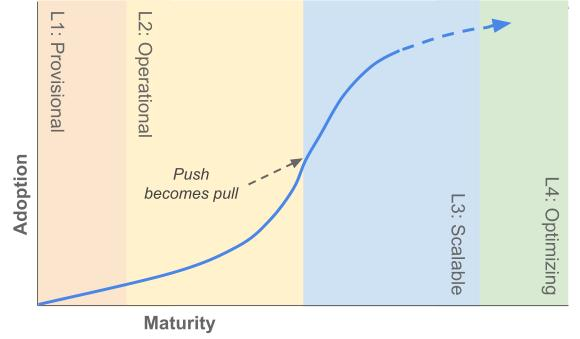
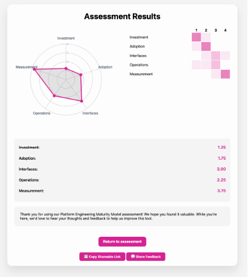
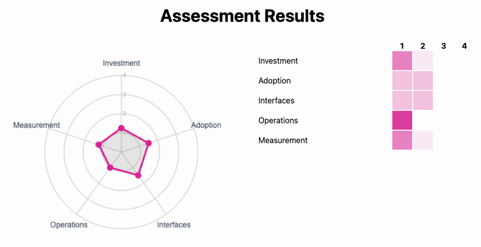
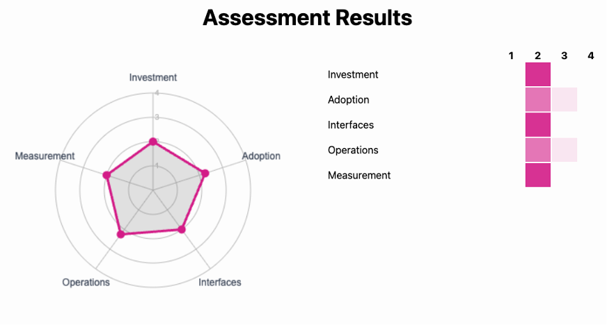
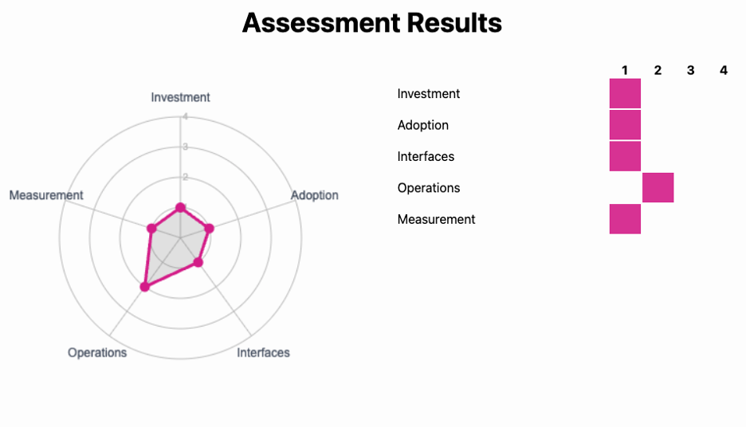
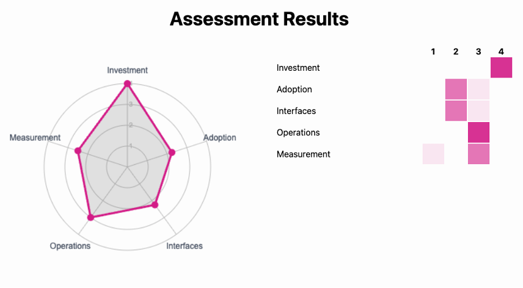

## Introduction

The CNCF's [Platforms White Paper]() defines internal platforms and the values they promise to deliver to enterprises.
To achieve these values, an organisation must reflect and deliberately pursue outcomes and practices, keeping in mind that every organisation relies on an internal platform crafted for its own expectations and requirements - even if that platform is documentation on how to use third party services.
This maturity model provides a framework for that reflection and for identifying opportunities for improvement.

This document refers to, enhances, and follows similar standards as the following related documents:

[Cloud Maturity Model](https://maturitymodel.cncf.io/)

[Platforms Whitepaper]()

## What is platform engineering?

Inspired by the cross-functional cooperation promised by DevOps, internal developer platforms and platform engineering have emerged in enterprises as an explicit form of that cooperation.

Platforms curate and present common capabilities, frameworks, and experiences that facilitate and accelerate the work of [**internal users**] () such as product and application teams.

[**Platform engineering**]() is the practice of planning and providing computing platforms to developers and users. It encompasses the whole platform, people, processes, policies, and technologies, as well as the desired business outcomes that drive them.

Please read the [CNCF Platforms White Paper]() first for additional context.

## How to use this model

As platform engineering has risen in prominence over the last few years, some patterns have become apparent. 
By organising those patterns and observations into a progressive maturity model, we aim to orient [platform teams]() to the challenges they may face. 
Each aspect is described by a continuum of characteristics of different teams and organisations at each level within the aspect.
We expect readers to find themselves in the model and identify opportunities in adjacent levels.

Of note, each additional level of maturity is accompanied by greater requirements for funding and people’s time.
Therefore, reaching the highest level should not be a goal in itself
Each level describes qualities that should appear at that stage
eaders must consider if their organisation and their current context would benefit from these qualities given the required investment.

Keep in mind that each aspect is meant to be evaluated and evolved independently.
However, as in any socio-technical system these aspects are complex and interrelated.
You may find that to improve in one aspect, you must reach a minimum level in another.

It’s also important to recognise that implementations of platforms vary from organisation to organisation.
Make sure to evaluate the current state of _your_ group’s overall cloud native transformation.
A phenomenal resource to leverage for this evaluation is the [Cloud Native Maturity Model](https://maturitymodel.cncf.io/).

Finally, this model encourages organisations to mature their platform engineering discipline and their resulting platforms through intentional planning.
Such planning and discipline themselves are a requirement for mature platform development and ongoing evolution.

In general, keep in mind that mapping your organisation into a model captures current state _to enable_ progressive iteration and improvement.
[Martin Fowler](https://martinfowler.com/bliki/MaturityModel.html) says it well: "The true outcome of a maturity model assessment isn’t what level you are at but the list of things you need to work on to improve. Your current level is merely a piece of intermediate work in order to determine that list of skills to acquire next."
In that vein, seek to find yourself in the model then identify opportunities in adjacent levels.

## Context behind this work

It's valuable to understand the context a document has been written in.
The following sections lay out some context behind the model.

### Intended audiences

EEach reader brings a unique context and will take unique learnings from this model. 
The following are some personas we have in mind, along with their possible motivations for engaging with this model:

* **CTOs, VPs, and directors of technology**: Leaders looking to map a path to digital transformation and greater developer productivity
* **Engineering managers**: Groups and individuals seeking to empower engineers to provide value with less overhead and higher efficiency
* **Enterprise architects**: Individuals navigating the modern technology landscape who seek a value- and solution-oriented perspective on technology problems
* **Platform engineers and platform product managers**: Teams and people seeking to build the best possible experience for platform builders and platform users
* **Product vendors and project maintainers**: Organisations and engineers wishing to design tools and deliver messages to enable users to succeed with platforms and capabilities
* **Application and product developers**: Platform users seeking to understand in more detail what they might expect of an internal platform

### Understanding the levels

This model is not meant to classify an organisation or platform team as wholly “Provisional” or “Optimising
Each aspect should be considered independently of the others; the characteristics of each level represent a continuum within that aspect but are not necessarily coupled to other aspects at the same level.
Even more so, many organisations will see characteristics of more than one level being applicable across their teams and work.
This is because no level is inherently good or bad, only contextual to the team’s goals.

The labels for each level are intended to reflect the impact of platform engineering at your organisation.
As you recognise your organisation at a given level you will gain insight into opportunities which follow at the next level.
Lower-numbered levels comprise more tactical solutions while higher-numbered ones are more strategic.

The levels suggest a potential process for platform development and maturity similar to other digital product development: first recognise a problem and need for a new solution, next develop minimally-viable products to assess potential solutions, third iterate to better solve the problem and ensure fit for your customers and finally scale and optimise the product to solve the problem for many teams and users.

Similar to the [CNCF Cloud Native Maturity Model](https://maturitymodel.cncf.io/), this model highlights that successful business outcomes can only be achieved through balancing people, process, and policy alongside technology.
Notably, this model introduces aspects which are often not fully in the remit of a single internal team, but rather require cooperation across the engineering department and quite often the wider organisation.

### But it doesn’t seem to fit

That’s perfectly fine\!
All organisations and groups have dynamics and parameters that are specific to them.

Keep in mind that the goal of this paper isn’t to prescribe a rigid formula, but rather a framework that you can apply to your circumstances.
Every word may not be relevant to you, but we hope the content will inspire you to reflect on your own platform journey, taking what makes sense and leaving the rest.

The objective of this model is to provide a tool to help guide platform engineering practitioners, stakeholders, and other interested parties on their journeys.
Platform design and implementation are not an exact science, but rather depend on the needs of an individual project, an organisation, and a particular time and place.

## Model table

| 
Aspect 
 |                                                                                            | Provisional            | Operational           | Scalable               | Optimizing                   |
|:---------------------------------------|:-------------------------------------------------------------------------------------------|:-----------------------|:----------------------|:-----------------------|:-----------------------------|
| [Investment](#Investment)     | _How are staff and funds allocated to platform capabilities?_                              | Voluntary or temporary | Dedicated team        | As product             | Enabled ecosystem            |
| [Adoption](#Adoption)         | _Why and how do users discover and use internal platforms and platform capabilities?_      | Erratic                | Extrinsic push        | Intrinsic pull         | Participatory                |
| [Interfaces](#Interfaces)     | _How do users interact with and consume platform capabilities?_                            | Custom processes       | Standard tooling      | Self-service solutions | Integrated services          |
| [Operations](#Operations)     | _How are platforms and their capabilities planned, prioritized, developed and maintained?_ | By request             | Centrally tracked     | Centrally enabled      | Managed services             |
| [Measurement](#Measurement)   | _What is the process for gathering and incorporating feedback and learning?_               | Ad hoc                 | Consistent collection | Insights               | Quantitative and qualitative |

## Model Detail




<h4 style="color:gray;padding-bottom:10px;padding-top:20px"><i>How are staff and funds allocated to platform capabilities?</i></h4>

Investment in platforms and platform engineering involves allocating budget, resources, and people to build and maintain common capabilities.
It is common for initiatives to be described as organically built from the bottom up, or driven through top down initiatives.
In either case, sustained effort is what drives high-impact work.
This aspect captures how the scale and breadth of investment can impact platform success.

### Level 1, Provisional — Voluntary or temporary

Individual capabilities may exist to provide common foundations for common or critical functionality.
These capabilities are built and maintained out of necessity rather than planned and intentionally funded.

These capabilities are built and maintained by people assigned temporarily or voluntarily; no central funding or staffing is intentionally allocated, nor is the work prioritised within the organisation.
They depend on their users' current tactical requirements.

#### Characteristics:

* People and time are allocated temporarily to tackle urgent requirements (i.e., [Tiger Teams](https://en.wikipedia.org/wiki/Tiger_team)).
These resources are not assigned nor granted the time to provide long term planning and support.  
* Migrations, improvements, or enhancements are often considered “nice to have” work items and rely on “research” or “hack day” efforts.  
* Process improvements or automation may be introduced while tackling a new requirement such as an urgent security patch, however there is no support to build the solutions in a reusable or sustainable way.  
* Employees complain of burn out and frustration with the amount of work they are doing outside their core role.

#### Example Scenarios:

* There is a specific employee who is viewed as the test environment expert. 
While this employee means well, their attempt to enable better test environments despite limited investment has increased risk, as there is no maintenance of their solution and no shared understanding of how to triage a broken test environment.  
* Engineers are encouraged to invest in capability improvements when there is no pressure from management for revenue generating features.
This translates to the last few days of some sprints, during which they prioritise automating and improving parts of their CI/CD pipeline.
It is not uncommon for these improvements to come in bursts, as there can be months of overly full sprints that do not allow time for these side endeavors.

### Level 2, Operationalised — Dedicated team or teams

Budget and people have been  allocated.
The assigned people are tasked with providing and supporting a set of commonly required capabilities to speed up software delivery.
Often, these teams focus on meeting reactive technical requirements.
They may be called DevOps, Engineering Enablement, Developer Experience (DevEx or DevX), Shared Tools, a Centre-Of-Excellence, or even Platform.
It may be multiple teams.They’re treated as cost centers and their impact on direct value streams and application teams is not measured.
It can be hard to map the impact of platform teams at this level within the organisation and its value streams, which can make it hard to sustain and fund such teams.

#### Characteristics:

* The team is composed almost entirely of technical generalists.  
* Team budgets may include infrastructure costs associated with their work, making them a key point in budget conversations.  
* Backlog items span multiple technologies, leading to frequent and large context switches.  
* This team is often the first to fill a gap that is not yet being addressed, even if it is not within the team's declared scope.  
* This team takes ownership of resources without an owner.  
* Assigned people rarely have the time or experience with customer research to validate their designs or implementations.

#### Example Scenarios:

* Application developers report long build times for their applications.
A centralised team is tasked with reducing the build time by 50%.
They solve this by doubling the size and quantity of the CI runners given they are not close enough to the software to individually improve the application builds.
This creates a budget concern for their centralised team as the productivity gain is not directly measurable against this increased infrastructure cost.

### Level 3, Scalable — As product

Investment in internal platforms and their capabilities is similar to investment in an enterprise’s outbound products and value streams: based on the value they are expected to provide to their customers.
Product management and user experience are explicitly considered and invested in.
A chargeback system may be used to reflect platforms’ impact on their customers’ own direct value streams and products.
The enterprise allocates funds, staffing, or establishes platform centric goals as top level outcomes.
The platform team tracks these initiatives using data-driven performance indicators and feedback loops. Additionally, platform teams can ultimately optimise the business itself and contribute to increased profitability.

#### Characteristics:

* Platform teams staff roles not traditionally found in internal serving or technical teams, for example, product management and user experience.  
* The team publicises a roadmap internally to the organisation, which indicates the value delivered and high level feature targets.  
* Features are tested for both implementation quality and user experience during design, delivery, and post deployment.  
* Feature removal is a key part of the conversation, the goal is to have a well supported, well used suite of capabilities instead of a sprawling estate that may not be maintained.

#### Example Scenarios:

* Data derived from platform usage metrics inform decisions to allocate funds and staff to the most impactful initiatives.

### Level 4, Optimising — Enabled ecosystem

Platform teams find ways to increase organisation-wide efficiency and effectiveness beyond basic capabilities.
Core platform maintainers intentionally strive to optimise time-to-market for new products, reduce costs, enable efficient governance and compliance for new services, scale workloads quickly and easily, and other cross-cutting requirements.
These core maintainers are focused on enabling platform capability producers to seamlessly integrate their requirements and offerings into existing and new parts of platforms.
Further, the organisation focuses people and resources from specialist domains like security, performance, quality on engaging with provided platform frameworks to introduce advanced features that can enable product teams to accelerate their adherence to company goals without depending on a centralised team backlog.

#### Characteristics:

* It becomes a priority to enable specialists to extend platform capabilities and introduce new ones.  
* The organisation can centralise specialists, allowing their knowledge and support to be spread through platform capabilities.

#### Example Scenarios:

* Marketing works with platform builders to introduce consistent user tracking in order to attribute marketing efforts to product outcomes.  
* An automation initiative reduces the time required to provision databases by 30 minutes per instance, saving $10m/year.




<h4 style="color:gray;padding-bottom:10px;padding-top:20px"><i>Why and how do users discover and use internal platforms and platform capabilities?</i></h4>

Adoption describes not only how and how much an organisation uses platform capabilities, but also what motivates them to do so.
In the early stages, many target users may not realise they are using a platform at all, rather they see their tools as an ad hoc collection of capabilities from various internal sources.
This may mature into a group of capabilities that is consistently managed and presented to users — that is, one or more platforms.
As the capabilities become more refined and discoverable, it is common that the drive for platform use moves away from more external motivations like mandates or incentives.
This leads to users self-selecting into platform capabilities and ideally even investing their own efforts into the wider platform ecosystem.

*Figure: A diagram to indicate a common growth pattern for platform adoption. This showcases the often slow start driven mainly by platform builders. Once platforms provide enough value to users, growth becomes more pulled by the users causing a steeper adoption curve.*

### Level 1, Provisional — Erratic

Adoption of shared platforms and capabilities is sporadic and inconsistent.
No organisation-wide strategy or guidance exists for choosing and integrating required backing services and technologies.
Individual teams might leverage platform practices to improve their own processes, but there is no coordinated effort or standardisation between multiple teams.
This level of adoption is characterised by the absence of a coherent approach and the idea that external tools are more effective than those provided internally.

#### Characteristics:

* One-off tools, services, and capabilities are managed by and consumed by various teams and departments in the organisation.  
* Provider-managed (aka “cloud”) services are adopted and used inconsistently and without standard practices and policies, as internal configurations are hard to find or use.  
* App and service teams discover tools and capabilities haphazardly, via rumors and chance conversations rather than through a more centralised process.  
* Coordination and reuse of components and capabilities is driven only by end users (application teams), if at all.  
* Product teams each maintain their own set of scripts or tools to deploy their applications.

#### Example Scenarios:

* A banking service requires a database.
A developer finds out from a friend on another team that they can request an AWS account and set up an RDS database.
From another team they find a Terraform script to provision that database.
For monitoring, they use CloudWatch on an ad hoc basis; they copy secrets from the AWS console to an instance of Hashicorp Vault manually before running the Terraform script.

### Level 2, Operationalized — Extrinsic push

The organisation recognises the value of shared platforms and capabilities and strives to encourage and nurture them.
Internal directives incentivise or even require the use of shared platform services for some use cases.
Some product teams use platform capabilities more than others; capabilities cover typical use cases in the organisation but not unusual ones; and it is difficult to add those outliers to the common platform.

User discovery of capabilities and how to use them is inconsistent; it is possible a user on a product team won’t discover a supported capability unless directed there by a platform team.

#### Characteristics:

* Some degree of external driving force leads to the use of platform capabilities, for example:  
  * Incentives such as personal reviews  
  * Mandates such as requiring use for production releases or receiving funding  
* The utilisation of platform capabilities is fragmented — users may take advantage of one capability but might not be aware of, or interested in adopting, others that are available.  
* Users have low motivation to learn how to use platform capabilities and rely heavily on collaboration with the providers through forums like office hours or help desk.  
* A very low engagement level from platform users unless the required capabilities or features are supported.  
* Platform users are encouraged to join informal communities of practice to share problems and solutions, but attendance may be limited.

#### Example Scenarios:

* An engineering organisation decides on a standard deployment tool and instructs all teams to use it.
New processes (communication of release notes, etc) are built around that standard.
Teams are instructed to stop using other sorts of deployment scripts and use the common tool instead.
This is difficult for some teams whose needs are not met by the new process but do not understand or are not allowed to extend it.

### Level 3, Scalable — Intrinsic pull

Users on product and service teams choose to use platforms and their capabilities because of the clear value they provide in reducing cognitive load on product teams while providing higher quality supporting services.
Documentation and ergonomic interfaces enable product team users to quickly provision and use platform capabilities.
Users choose internal platform implementations over alternatives such as developing the capability themselves or hiring a provider.

#### Characteristics:

* Platform adoption is self-sustaining – The primary driver for core adoption is not an external factor or incentive which mandates users to use platform offerings – rather, it is the values of these platform offerings themselves which draws users to them.  
* After using and appreciating one or more platform capabilities, users seek out others and find the experience is similar across capabilities.
There is an expectation that an individual capability is not isolated, rather it is one feature among a larger platform feature set.  
* Platform teams encourage the natural adoption of platforms by gathering user feedback, sharing roadmaps, publishing update announcements or a regular newsletter and maintaining open forums for conversation with users.  
* Application and product teams value platform capabilities enough to pay for them, e.g., via a chargeback model.  
* Users can share feedback and learn about upcoming features through open forums and shared roadmaps.  
* Self-serve portals and documentation to enable rapid use.

#### Example Scenarios:

* An application team previously had success requesting a new database.
Their process was easy to understand and required almost no waiting time.
In addition, key capabilities like backups and monitoring that allowed the team to progress their use all the way to production without issue were included.
This experience meant that when the team later needed a queue, their first instinct was to check for an internal platform option.
While they originally intended to use a specific queue technology, in the end, they chose to use the one offered internally since they knew how well integrated the solution would be for their organisation.

### Level 4, Optimising — Participatory

Users from product teams further invest in platform capabilities by joining the platform ecosystem and contributing back to it as platform capability producers.
Some contributions improve and fix existing capabilities; others introduce new capabilities and features to address new use cases.
Processes and services are defined and enable users to identify requirements and coordinate contributions amongst several product and platform teams.
New capabilities are published via consistent interfaces and portals and with complete documentation and standard versioning with release notes.

#### Characteristics:

* Users in app/service teams are empowered to contribute fixes, features, and feedback for platform capabilities.  
* External projects and standards are strategically leveraged to reduce maintenance costs, accelerate new feature delivery, and use organisation headcount most effectively.  
* New capabilities and enhancements are coordinated asynchronously through issue boards and pull requests.
Documents and checklists enable self-driven development by contributors.  
* Developer advocates and internal ambassadors build and support an internal user community that extends platform ownership to app and service team contributors.  
* Use of platform capabilities is viewed as the best way of working at the organisation by both leadership and individual contributors.  
* Platform engineers participate in product team planning to learn of requirements and suggest relevant existing capabilities.

#### Example Scenarios:

* A team wants an alternative backup plan.
After proposing this as a general offering, it is deemed low priority due to minimal reuse.
The proposing team chooses to integrate their solution into the platform framework and make it available to the organisation.
It is originally an alpha offering but once it meets all of the operational requirements can be promoted to a core platform capability.




<h4 style="color:gray;padding-bottom:10px;padding-top:20px"><i>How do users interact with and consume platform capabilities?</i></h4>

The interfaces provided by platforms affect how users interact with these platform offerings to provision, manage, and observe capabilities.
Interfaces can include ticketing systems, project templates, graphical portals including those commonly referred to as an internal developer portal, as well as APIs and command-line tools.

Key characteristics of an interface include how discoverable and user-friendly it is during key user journeys like initial request, maintenance, or incident triage.
Higher levels of maturity here reflect more integrated, consistent, automated, and supported interfaces.

### Level 1, Provisional — Custom processes

A collection of varying processes exists to provision different capabilities and services, but the consistency of the interface is not considered.
Custom tailor-made processes address the immediate needs of individuals or teams and are reliant on manual intervention, even if the provider uses some automated implementation scripts.

Knowledge of how to request these solutions is shared from person to person.
The process for requesting a service lacks standardisation and consistency.

Simple requests are complicated because processes are hard to discover.
Provisioning and using a platform service likely requires deep support from the capability provider.
Provisioning could be performed on request as the result of a ticket or other request mechanism.

Lack of central requirements and standards makes this level appropriate when the company has not yet identified and documented expectations.
It can be particularly effective for teams at early stage companies or platform efforts.
In these environments, teams are provided the freedom to evolve processes and capabilities to their needs, allowing them to deliver more quickly and pay the price of standardisation only when necessary later on.

#### Characteristics:

* User interaction is not a key topic of discussion and rarely (if ever) are interactions tested during the design and delivery of new capabilities.  
* Capabilities are mainly provided through manual requests, though providers may choose to automate some or all of the activities necessary to provision a user request.  
* Sometimes a process appears to be agreed, but users run into issues when a different department or team gets involved.

#### Example Scenarios:

* An application team wants to run performance testing for their new change.
To do this, they want an isolated environment that contains enough test data to get an accurate performance read.
The last time they had this request, a former teammate was able to get access to an environment, and no one knows how to recreate it.
In the end, they raise a service ticket and are connected to an engineer on the infrastructure team who is able to provision them an environment in a few days.  
* A team in the exploratory phases of product development uses a custom process to provision a new cloud service without needing to validate that their solution warrants further investment.  
* A team wanting a new development environment comprising capabilities from multiple different teams is following instructions a teammate has pulled together and shared with them all via email.
Ticket requests to multiple teams and multiple handoffs are involved in the process as well as the requester having to carry out a number of pre-requisite steps/requests themselves before raising each ticket.

  For example, multiple different requests require details of LDAP directory groups which will be used to control access.
  Each team involved in the end to end solution uses different naming conventions unique to their capability.
  Multiple requests need to be raised to the Security team to have each group created first before provisioning requests can be made.  
* Teams across the organisation expose different types of interfaces for the request and provisioning of their platform capabilities.
There are multiple team specific ticketing systems as well as a more central system where some teams have directly exposed the API’s which their hardware vendor has made available within the product, whilst other teams provide the Infrastructure as Code (IaC) modules and instructions on how to use Cloud Service Provider APIs.

### Level 2, Operationalised — Standard tooling

Consistent, standard interfaces for provisioning and observing platforms and capabilities exist and meet broad needs.
Users see and interact with the tools that form the platform, are able to identify what capabilities are available, and are enabled to request capabilities that they require.

“Paved roads” or “golden paths”, in the form of documentation and templates, are provided.
These resources define how to provision and manage typical capabilities using compliant and tested patterns.
While some users are able to use these solutions on their own, the solutions often still require deep domain expertise and therefore support from maintainers is still vital.
Some basic offering of self-service provisioning of capabilities using a variety of tools may exist at this level but they may not be as tightly integrated as required for Level 3\.

#### Characteristics:

* Technical solutions are built-in tools specific to their problem domain, not always tools familiar to the users.  
* There is investment in a common path; however, deviating from that path quickly uncovers few customisation options as the focus was on building a single option.  
* Given standardisation, informal internal groups are able to form and gather to share good practices and overcome shared problems.  
* There may be drift on capability implementation as teams take templates, customise them, and then cannot merge in changes from the centralised team.

#### Example Scenarios:

* A centralised team curates a library of Terraform modules, Kubernetes controllers, and CRDs for provisioning different types of infrastructure.  
* A shared location includes comprehensive documents about solutions across the organisation.  
* A basic internal developer portal may be in place and used as the centralised interface to signpost information about the above consistently to Users.  
* Technical teams have formed communities of practice or other forms of regularly meeting to share ideas and best practice and start to create a more standardised approach.
“How” users interact with the teams and consume their capabilities is now a consideration.

### Level 3, Scalable — Self-service solutions

Solutions are offered in a way that provides autonomy to users and requires little support from maintainers. 
The organisation encourages and enables solutions to provide consistent interfaces that enable discoverability and portability of user experience from one capability to another.
While self-service, the solutions do require team awareness and implementation.
In order to improve this experience, there may be a guided and simplified internal language which enables users to adopt and integrate platform capabilities more quickly.
This generates a user-centric, self-serviceable, and consistent collection of capabilities.

#### Characteristics:

* Users see and interact with the tools through abstractions, not directly.  
* Solutions are easy to request, provided as “one-click” implementations, enabling teams to benefit from a capability without needing to understand how they are provisioned, nor having to progress any “pre-requisites” before performing a self service request.  
* While the solutions are easy to consume, there may not be as much usability built into the day 2 and beyond management of the solution.  
* There continues to be a narrow path of available solutions, leaving users with unique requirements unsure how to proceed.

#### Example Scenarios:

* An API is provided, which abstracts the creation and maintenance of databases and provides users with any information they require to leverage the platform capability such as a connection string, location for secret data, and a dashboard with observability data.  
* The internal developer portal discussed at Level 2 has evolved from just being about documentation. At this level, this now includes a self-service user interface for provisioning many different capabilities.

### Level 4, Optimising — Managed services

Platform capabilities are transparently integrated into the tools and processes that teams already use to do their work.
Some capabilities are provisioned automatically, such as observability or identity management for a deployed service.
When users hit the edges of the provided services, there is an opportunity to move past automated solutions and customise for their needs without leaving the internal offerings because platform capabilities are considered building blocks.
These building blocks are used to build transparent and automatic compositions to meet the higher-level use cases while enabling deeper customisation where necessary.

#### Characteristics:

* It is clear what capabilities are differentiating for the organisation and which are not, allowing the internal teams to invest in custom solutions only where they can not leverage industry standards.  
* While capabilities are surfaced in a consistent way, there is no one way to use a capability.
Some are best suited as CLI tools for use in scripts, whereas others benefit from integration into where the user is writing code in their editors, IDEs, Agentic AIs.  
* The value of individual capabilities is extended with a focus on the flow of both software development and release, leading to a focus on how to combine capabilities into higher level offerings.  
* While capabilities are often provided in packages, expert users can decompose, contribute and reassemble these higher level offerings in order to optimise when and where they need to.

#### Example Scenarios:

* Observability agents are injected into every workload, and an OIDC proxy is placed in front of all applications.  
* By default, every new project receives a space in a task runner (pipelines) and a runtime environment (K8s namespace), however, a project can opt into other options such as serverless runtime.  
* Within an IT Service Management Portal catalog, a user selects “Provision a Database.”
Automation provisions a database instance and sends a URL and location to get the credentials to the user.  
* Fully orchestrated solutions are available as “Products” within the Internal Developer Portal, as well as via API and command line for provisioning.
Different teams can use whichever interface is most appropriate to them and consistently achieve the same result each time.
“Add-on” component capabilities are also available as optional building blocks which consumers can add into their environment.
More expert users can contribute to the codebase of components and Products.




<h4 style="color:gray;padding-bottom:10px;padding-top:20px"><i>How are platforms and their capabilities planned, prioritised, developed and maintained?</i></h4>

Operation of platforms covers how an organisation manages platform capabilities over their full lifecycle: from accepting requests, through delivery, upgrades, maintenance, user support, and potentially deprecation.
The majority of operational effort is spent after a capability's initial release, in ongoing maintenance, incident response, user enablement, and iterative improvement.

Platforms exist to serve their users, so operational practices must be oriented around delivering and evolving a reliable service rather than maintaining infrastructure.
Users who trust that capabilities will be kept current, well-supported, and continuously improved, and as a result, users will adopt and depend on the platform.
Earning that trust requires platform teams to prioritise the activities that deliver the greatest business value, balancing new capability development against the ongoing demands of the existing portfolio.

### Level 1, Provisional — By request

Platforms and capabilities are developed, published, and updated reactively, based on ad-hoc product team requests and requirements.
Product teams themselves may even need to plan and build the capabilities they require.

Teams who build a new capability, whether dedicated centralised teams or application teams meeting their own needs, take only informal responsibility for supporting others using it.
They are not expected to actively maintain it and few processes exist to assess the quality of the offering.
In this level, implementations are often ignored until a security vulnerability is discovered, a bug prevents use, or a new requirement arrives, at which point another reactive plan may be quickly implemented.

#### Characteristics:

* Capabilities are created to meet the immediate needs of individual application teams, with no broader roadmap or intake process.  
* Planning focuses on initial delivery; no investment is made in ongoing maintenance, sustainability, or deprecation.  
* Capability implementations are frequently out of date and awaiting updates that no one has scheduled.  
* Late-breaking, high-impact changes (such as the discovery of a critical vulnerability) create sudden, unplanned spikes of work.  
* Upgrades are handled in a different way each time, requiring fresh research and a new process for every change.  
* Changes can result in both planned and unplanned downtime, with limited ability to predict or mitigate impact.  
* No formal feedback mechanism exists for users to report issues, request improvements, or understand upcoming changes.

#### Example Scenarios:

* Log4Shell security vulnerability is announced, and the organisation spins up a dedicated team to investigate where the organisation may be vulnerable and instigate patches.
Once the team identifies the impact, they must work hand in hand with a number of different teams since each one manages their servers and upgrade processes differently.
Even when this work is deemed complete, the confidence level is fairly low that there won’t be more instances uncovered.

### Level 2, Operationalised — Centrally tracked

Platforms and capabilities are centrally documented and discoverable, and processes for planning and managing the lifecycle of capabilities are at least lightly defined.
Responsibility and ownership is well documented for each service and function.
Lifecycle management processes vary for different capabilities depending on their owners and their priorities.
A centralised team maintains, or is capable of generating, an inventory of capabilities that provides the list and state of current capabilities.
This allows the organisation to track progress towards capability offering and compliance with upgrade requirements.

#### Characteristics:

* Application teams create new capabilities as needed and register them centrally.  
* A central team provides a register of available shared services and their ownership.  
* Loose standards, such as requiring an automatable API and user documentation, are applied to capabilities.  
* Infrastructure as Code (IaC) is used to allow easier traceability of deployed services and reduce configuration drift.  
* Audits for compliance regulations such as PCI DSS or HIPAA are enabled through the service inventories.  
* Migration and upgrade work is tracked against a burndown chart, which enables the organisation to track the rate of compliance and time until completion.  
* Tracking does not indicate the level of support; upgrades often remain manual and vary in quality.  
* Users can discover what capabilities exist and who owns them, but the quality and timeliness of support remains inconsistent across capabilities.  
* Early forms of cost visibility may emerge, such as tagging infrastructure to attribute spend to specific capabilities or teams.

#### Example Scenarios:

* An organisation's PostgreSQL version is going EOL by the end of the year.
The organisation is aware of which databases require an upgrade and is scheduling the work on each team’s backlog to complete.

### Level 3, Scalable — Centrally enabled

Platforms and capabilities are not only centrally registered but also centrally orchestrated.
Platform teams take responsibility for understanding the broad needs of the organisation and prioritise work across platform and infrastructure teams accordingly.
Those responsible for a capability are expected to not only maintain it technically, but also provide standard user experiences for integrating the capability with other related services around the organisation, ensure secure and reliable use, and even provide observability.

Standard processes for creating and evolving new capabilities exist, enabling anyone in the organisation to contribute a solution that meets expectations.
Continuous delivery processes for platform capabilities and features enable regular rollout and rollback.
Large changes are planned and coordinated as they would be for customer-facing product changes.

#### Characteristics:

* Application teams request capabilities from platform teams before building their own.  
* New capabilities adhere to standard practices: consistent interfaces, documentation, governance, and observability.  
* Upgrade processes are documented, consistent across services, and tested before rollout.  
* Platform teams publish service level objectives (SLO’s) for key capabilities, with defined incident escalation paths and post-incident reviews.  
* Deprecation follows a published process with advance notice, migration tooling, and a hard end-of-life date.  
* A product management discipline drives prioritisation through user feedback, usage data, and strategic alignment.  
* Cost allocation models, such as showback or chargeback, link platform consumption to the value streams that use them.

#### Example Scenarios:

* The organisation is going to upgrade its Linux distribution.
In doing so, each application team needs to validate that their software continues to work.
In order to enable this testing phase, the centralised compute team is setting up test environments for each team with the correct software and OS versions.

### Level 4, Optimising — Managed services

The lifecycle of each capability is managed in a standardised, automated way.
Capabilities, features and updates are delivered continuously with no impact on users.
Any large changes instigated by platform providers include migration plans for existing users with defined responsibilities and timelines.

Platform capability providers take on the brunt of responsibility for maintenance, but there is a clear contract — a “shared responsibility model” — describing the responsibilities of users, enabling both sides to operate mostly autonomously.

#### Characteristics:

* A shared responsibility model is explicit, published, and versioned as a living document.  
* Upgrades are automated with progressive rollout strategies and automated validation at each stage.  
* Platform capabilities report against SLOs.  
* Operational data (incidents, usage patterns, cost trends) feeds directly into roadmap prioritisation.  
* Cost optimisation is a continuous discipline, with active right-sizing and consumption visibility for users.  
* Deprecation and migration are handled through automated tooling on behalf of users.  
* The platform team measures outcomes rather than output, iterating based on evidence.

#### Example Scenarios:

* The users of virtual machines are not required to manage anything to do with version upgrades.
Their only requirement is to have a stage in their delivery pipeline that contains a representative smoke test.
They are then asked to declare their application as having lower risk tolerance so as to wait for a fully hardened upgrade or higher tolerance to become an early adopter.
The virtual machine capability then manages the automated release of upgrades including rollbacks after either smoke test or canary release failures.




<h4 style="color:gray;padding-bottom:10px;padding-top:20px"><i>What is the process for gathering and incorporating feedback and learning?</i></h4>

By responding to explicit and implicit user feedback, organisations can increase user satisfaction and ensure long-term platform sustainability.
Organisations must balance innovation and meeting user demands to keep platform relevance.
As technology and user preferences change, platforms that are agile and responsive will excel.
Regularly revisiting and refining the feedback mechanism can further optimise platform development and improve user engagement.

### Level 1, Provisional — Ad hoc

Usage and satisfaction metrics are gathered in custom ways, if at all, for each platform and capability.
Outcomes and measures of success are not consistently aligned across capabilities, which means corresponding insights are not gathered.
User feedback and instrumentation of platform use may not be gathered, or if it is, it will be informal.
Decisions are made based on anecdotal requirements and incomplete data.

#### Characteristics:

* No clear approach to measuring platform success  
* Use familiar tools to gather common metrics with limited intent and forethought  
* Reliance on small samples  
* Users are disengaged and don't believe their feedback is used  
* Surveys are sporadic and progress over time isn't tracked

#### Example Scenarios:

* A platform tech lead wants to improve the collaboration with users by adding key topics to their next quarterly planning.
They decide to run a survey on what users would like to see.
The response is overwhelming, which is exciting, but also results in a difficulty organising and responding to all of the ideas.
While some ideas influence the quarterly planning, the users do not see their ideas as being accepted and are less inclined to reply to the next survey.  
* The team wants to capture more data automatically, so they look for opportunities for easy collection such as test failures in CI.
However, not every team uses the same CI automation so the data is only available for Java applications even though some teams have moved on to writing their services in Scala.

### Level 2, Operationalised — Consistent collection

Organisations at this level have an intentional goal to verify platform products meet the needs of their market of internal users.
Actionable, structured collection of user feedback is valued.
Dedicated teams or individuals might be assigned to gather feedback, ensuring a more consistent approach.
Feedback channels, such as surveys or user forums, are standardised, and feedback is categorised and prioritised.
Beyond user feedback, there is also an expectation that user experiences are instrumented to generate usage data over time.

Challenges remain in translating feedback into actionable tasks.
While there is a growing repository of user data, the organisation might need help effectively understanding and integrating this feedback into a platform roadmap.
It may be hard to ensure that users see tangible changes driven by their feedback.

#### Characteristics:

* There are competing ideas on measurement, and a lack of alignment between teams.  
* Data collection is discussed as part of most major planning sessions or capability implementations.  
* There may not be alignment on exactly what to measure to verify success.  
* Platform features can be measured for success, such as by measuring user adoption or user time saved.

#### Example Scenarios:

* A platform team allocates 20% of their time to user defined features, which they identify based on surveys and other interview techniques.
Their findings are collected into a tool that enables additional voting and commenting to further refine priorities.
During implementation, the requesting users are approached for collaboration on early designs and implementations.
Once implemented, there are announcements which make sure requesting users are aware of new features and supported in adopting them.  
* The team focused on software delivery capabilities wants to capture more data automatically including cycle time which they automate through the build tool from commit to production.
There is an understanding that cycle time can include other activities like PR review, but that isn’t included at this time.

### Level 3, Scalable — Insights

While robust, standard feedback mechanisms already exist, at this stage data is collected in crafted ways to yield specific strategic insights and actions.
Desired results and outcomes are identified followed by standard metrics chosen to indicate progress towards those outcomes.
Industry frameworks and standards may be used to benefit from industry research on the impact of certain behaviors.

Dedicated teams or tools are employed to gather and review feedback and summarise data into themes and actionable insights.
A symbiotic relationship between platform products and their users is established.
Feedback is considered a strategic asset that guides platform operations and roadmap.
Regular feedback review sessions might be instituted, where cross-functional teams come together to discuss and strategise based on user insights.

#### Characteristics:

* Before delivering any new platform feature, the team agrees how to evaluate the outcome of their work.  
* The organisation has broad alignment on measures that indicate success of platform initiatives.  
* A [product manager]() or dedicated team member drives an ongoing and consistent feedback collection and analysis process.  
* The organisation has established metrics and goals that indicate success.

#### Example Scenarios:

* The organisation has consistently tracked build times and lead time.
However, now they realise that while easy to collect, these alone do not give a complete picture of software delivery.
With this in mind, the team implements measurement for service reliability and stability.

### Level 4, Optimising — Quantitative and qualitative

Feedback and measurements are deeply integrated into the organisation’s culture.
The entire organisation, from top-level executives to engineers recognises the value of data collection and feedback on product evolution.
There is a democratisation of data, where various stakeholders, including platform users and business leaders, are actively involved in identifying hypotheses for platform improvements, providing feedback during the design process, and then measuring the impact post delivery.
All of these measurements are considered when planning platform initiatives.

Not only are standard frameworks leveraged, but there is an understanding that measuring from multiple angles creates a more holistic picture.
There is an investment in understanding how qualitative measures change as quantitative ones are improved.
There is a focus on identifying leading indicators that can allow anticipation of features that would support user needs, alleviate their challenges, and stay ahead of industry trends and business requirements.

#### Characteristics:

* Platform teams continuously seek ways to improve the metrics they watch and the way they gather data.  
* The organisation is familiar with and sensitive to [Goodhart’s Law](https://en.wikipedia.org/wiki/Goodhart%27s_law): “When a measure becomes a target, it ceases to be a good measure.”  
* Gathered metrics and telemetry are continuously evaluated for true insight and value.  
* Metric data management is well supported, such as standard platform capabilities to manage data lakes and derive insights.  
* Cross-departmental collaboration is encouraged to avoid data silos and enable effective feedback cycles.  
* Surveys are consistent and allow quantifiable measures to be tracked over time

#### Example Scenarios:

* Over time the organisation has collected data indicating a rise in build time of over 15%.
This triggers negative developer experiences and once triggered, even if the build time is reduced below the original time, developers stay frustrated for longer.
This insight drives the build team to set and adhere to service level objectives (SLOs), which enables early identification and improvement before instigating the negative cycle with their users.




 

---
## Conclusion

Platforms and their maintainers provide a foundation for agile digital product development.
They provide a consistent collection of capabilities that enable efficient software development and delivery.  
This maturity model provides a map for your platform engineering journey.
Rather than using it to categorise your organisation, or provide a finishing line, it helps you understand where you are and plan your next move as part of a continuous capability development process.

A few principles are worth carrying forward as you apply this model:

* Context should determine ambition.
The highest level of maturity is not necessarily the target for every organisation.  
* The aspects can be interconnected.
High maturity in one aspect, like adoption, may be inappropriate without maturity in other aspects, like investment.  
* People and culture precede technology.
The maturity levels depend on human behaviour, communication, trust, and feedback, not just tools.  
* The platform's purpose is measured in the success of product teams. Each capability, interface, and measurement should be evaluated through the lens of people building software on top of the platform.

Platform engineering, practised with intention, becomes a multiplier on everything else the organisation does.
This model is an invitation to that practice.

| 
Aspect 
 |                                                                                            | Provisional            | Operational           | Scalable               | Optimizing                   |
|:---------------------------------------|:-------------------------------------------------------------------------------------------|:-----------------------|:----------------------|:-----------------------|:-----------------------------|
| [Investment](#Investment)     | _How are staff and funds allocated to platform capabilities?_                              | Voluntary or temporary | Dedicated team        | As product             | Enabled ecosystem            |
| [Adoption](#Adoption)         | _Why and how do users discover and use internal platforms and platform capabilities?_      | Erratic                | Extrinsic push        | Intrinsic pull         | Participatory                |
| [Interfaces](#Interfaces)     | _How do users interact with and consume platform capabilities?_                            | Custom processes       | Standard tooling      | Self-service solutions | Integrated services          |
| [Operations](#Operations)     | _How are platforms and their capabilities planned, prioritized, developed and maintained?_ | By request             | Centrally tracked     | Centrally enabled      | Managed services             |
| [Measurement](#Measurement)   | _What is the process for gathering and incorporating feedback and learning?_               | Ad hoc                 | Consistent collection | Insights               | Quantitative and qualitative |

# Platform Maturity Model Self Assessment Tool

The Platform Maturity Assessment is a tool produced by the CNCF Platform Engineering Technical Community Group to accompany the Platform Maturity Model.

The aim of the self assessment tool is to help organisations to quickly assess and identify their maturity level according to the categories in the Maturity Model as a source for guidance on improving their capabilities.

The self assessment tool scores responses for each category in the maturity model. This information is shown in three ways in the assessment’s output:

1. Spider chart: Uses the average score in each category to highlight strengths and weaknesses.  
2. Matrix: Plots answer density to show the spread within each category.  
3. Table: Displays average scores per category.

*An example output diagram from the platform engineering maturity model*

You can access the Self Assessment Tool at [https://cloud-native-platform-engineering.github.io/pemm-assessment/](https://cloud-native-platform-engineering.github.io/pemm-assessment/)

# Maturity Model Examples

The following company “personas” represent some of the semi-fictitious data created for use in testing the Maturity Model Self Assessment Tool by members of the CNCF Platform Engineering Technical Community Group using their own experiences.

By including these within the latest revision of the Maturity Model we aim to provide some worked examples which readers of this document can follow and relate back to each of the sections covered within the model.

Over time, our aim is to mature these examples to show how companies have matured from one position to another through their Platform Engineering journey, possibly replacing the fictitious companies with real life case studies. If you are interested in sharing your platform maturity journey, please get in touch with us by using the CNCF Slack channel \#platform-engineering

### Example A \- Fintech Startup (Rapid Growth, 50 employees, Cloud-Native, Agile) 

This startup prioritises speed and agility in developing new financial products. They've embraced a cloud-native approach and Agile methodologies. Platform responsibilities are shared among senior engineers, with no dedicated team. They rely heavily on managed services and prioritise rapid iteration over building extensive internal platform capabilities. The CTO makes key platform decisions, working closely with the lead engineers. Key stakeholders are the engineering team and early adopters/customers providing feedback.

**Tech Stack:** Primarily serverless technologies (AWS Lambda, Google Cloud Functions), container orchestration (Kubernetes), and managed databases. Fully cloud-native.

**Investment:** Provisional (Ad-hoc contributions from senior engineers, limited budget specifically for platform work)

**Adoption:** Operationalised (Driven by practical needs, high reliance on readily available managed services)

**Interfaces:** Operationalised (Leveraging standard cloud provider tools and APIs, some open-source tools)

**Operations:** Provisional (Automated deployments where possible, reliance on managed services for operations, basic monitoring)

**Measurement:** Provisional (Informal feedback from engineers, basic usage metrics tracked by cloud providers)

 

### Example B \- Healthcare Provider (Mid-sized, 1,000 employees, On-Premise/Migrating to Cloud, Waterfall/Agile Hybrid)

This healthcare provider is gradually migrating from on-premise infrastructure to the cloud while navigating complex regulatory requirements. Their small platform team is tasked with enabling this transition while ensuring compliance with HIPAA and other regulations. Reporting to the Director of IT, the platform team works closely with security and compliance teams but faces resistance from some clinical teams who are hesitant to adopt new technologies. Key stakeholders include medical staff, IT, legal/compliance, and patients (indirectly).

**Tech Stack:** Mix of .NET and Java applications, some containerisation, and a growing adoption of cloud-managed services. Cloud adoption is increasing but constrained by legacy systems and regulatory concerns.

**Investment:** Operationalised (Small platform team, budget constrained by regulatory requirements)

**Adoption:** Operationalised (Mandated for some applications, challenges with legacy system integration)

**Interfaces:** Operationalised (Mix of standard tooling and custom scripts, limited API coverage)

**Operations:** Operationalised (Centralised change management, manual deployments, basic monitoring)

**Measurement:** Operationalised (Regular reporting on platform usage, some user feedback collected)  

*An example output diagram from the platform engineering maturity model*

### Example C \- Manufacturing Company (Traditional, 5,000 employees, On-Premise/Migrating to Cloud, Waterfall)

**T**his traditional manufacturing company is in the early stages of cloud adoption, primarily focused on migrating existing on-premise applications to the cloud. Platform work is primarily handled by the existing infrastructure team, who are focused on migrating on-premise applications to the cloud and ensuring operational stability. The Director of Infrastructure makes platform decisions, often influenced by vendor recommendations and industry best practices. Key stakeholders are operations, manufacturing/plant managers, and IT.

**Tech Stack:** Primarily .NET and Java applications, limited containerisation, and some cloud-managed services for specific use cases. Cloud adoption is nascent.

**Investment:** Provisional (Resources allocated as part of general infrastructure budget, no dedicated platform team)

**Adoption:** Provisional (Low adoption, primarily driven by IT mandates, resistance to change)

**Interfaces:** Provisional (Custom scripts and manual processes, limited tooling)

**Operations:** Operationalised (Centralised IT operations, slow and manual deployments)

**Measurement:** Provisional (Basic infrastructure metrics, limited user feedback)

*An example output diagram from the platform engineering maturity model*

### Example D \- Large Bank (Established, 100,000 employees, Hybrid Cloud, Waterfall/Agile Hybrid)

This large bank is undergoing a digital transformation, gradually adopting Agile methodologies and migrating some services to the cloud. Their large platform team is facing significant challenges integrating legacy systems and complying with stringent regulatory requirements. The platform team reports to the CIO and must navigate a complex organisational structure with multiple stakeholders and competing priorities. Key Stakeholders include various lines of business (LOB), legal/compliance, security, operations, and executive management.

**Tech Stack:** A highly diverse and complex mix of legacy mainframe systems, Java and .NET applications, and some cloud-native services. Cloud adoption is growing but still limited.

**Investment**: Optimising (Very large platform team with multiple sub-teams, substantial budget, but also significant legacy constraints)

**Adoption**: Operationalised (Mandated for new applications, slow adoption for existing systems due to complexity and risk aversion)

**Interfaces**: Operationalised (Complex mix of legacy systems and modern tooling, self-service limited by security and compliance requirements)

**Operations**: Scalable (Highly regulated change management processes, automated deployments for some services, robust monitoring and disaster recovery)

**Measurement**: Scalable (Extensive reporting and metrics collection, but challenges with data analysis and actionable insights due to scale and complexity)

